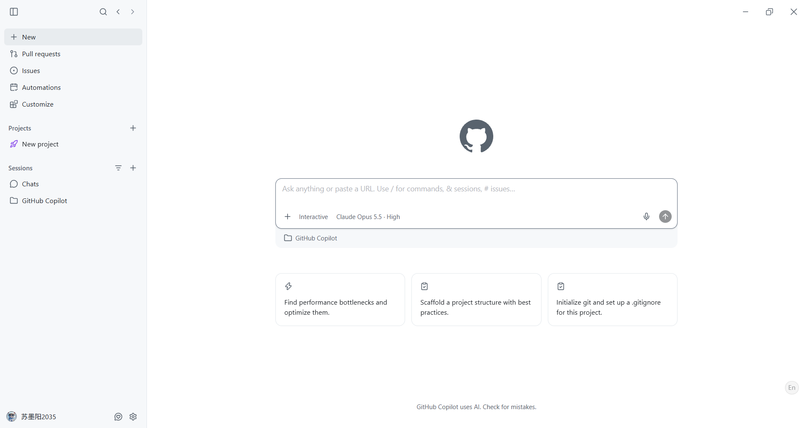
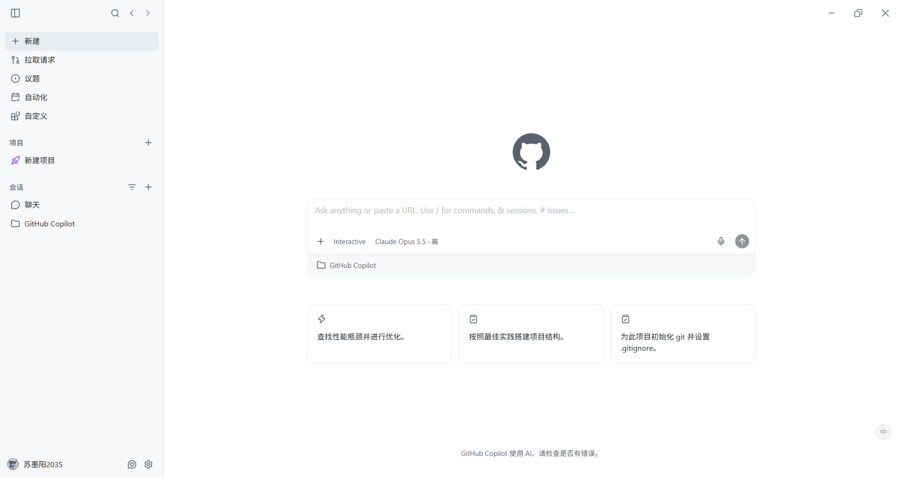
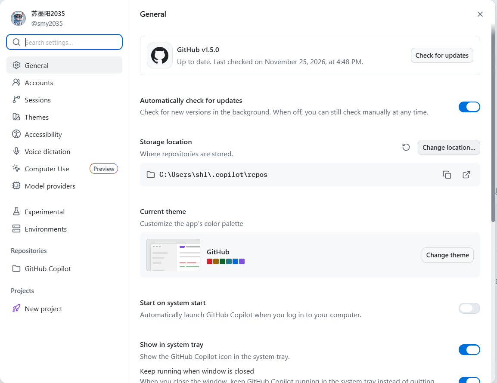
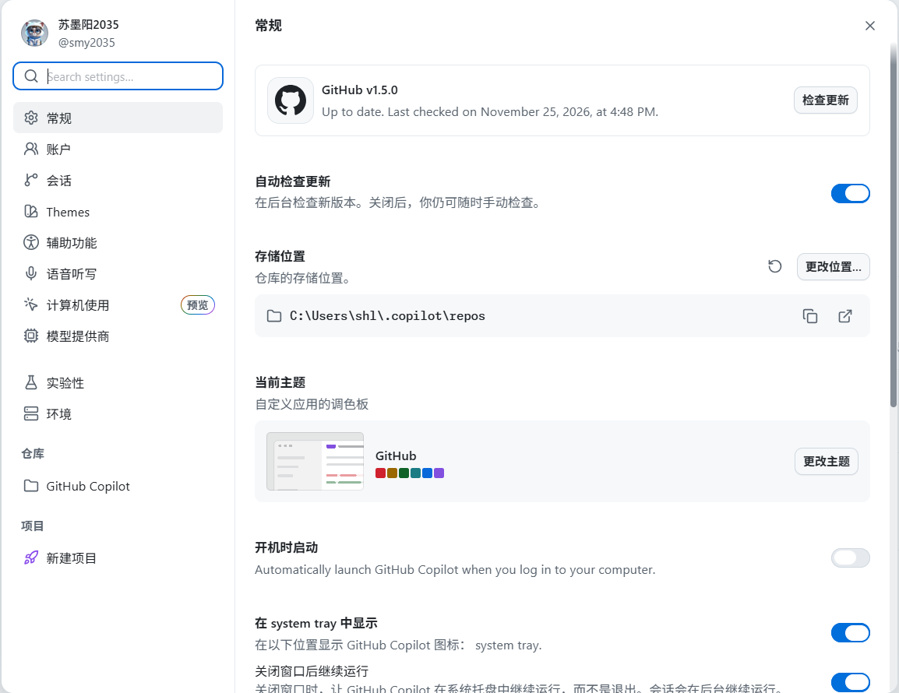
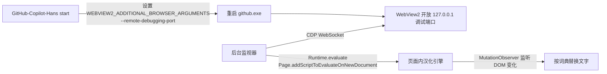

# GitHub Copilot 汉化工具 (GitHub-Copilot-Hans)

为 **GitHub Copilot 桌面版**提供中文界面。**不修改任何安装文件**，随时可以一键切回英文。

> [!IMPORTANT]
> - **非官方项目**，与 GitHub、Microsoft 无任何关联。"GitHub"、"Copilot" 是其各自所有者的商标。
> - **仅支持 Windows**。macOS / Linux 暂不支持，原因见[下文](#为什么只支持-windows)。
> - 适配版本：GitHub Copilot 桌面版 **v1.5.0**（内置词典约 16,000 条）。应用更新后，新增的界面文字可能显示为英文。

| 英文原版 | 汉化后 |
|---|---|
|  |  |
|  |  |

## 快速使用

需要先安装 [Node.js 22 或更高版本](https://nodejs.org/)。

1. 下载本仓库（绿色 **Code** 按钮 → **Download ZIP**），解压到任意位置。
2. 双击 `GitHub-Copilot-Hans.cmd`，选 **1. 启动汉化**。工具会重启一次 GitHub Copilot（正在执行的任务会中断，会话记录会保留）。
3. 汉化生效后，窗口右下角有一个半透明的 **「中」** 圆钮：单击切换中/英文，按住可拖动位置。
4. 以后想一键启动：菜单里选 **2. 创建桌面快捷方式**，之后用桌面上的「GitHub Copilot 中文版」代替原图标启动即可。

维护用的命令（菜单里不显示）：

```bash
GitHub-Copilot-Hans.cmd start      # 启动汉化（必要时重启应用；加 --yes 跳过确认）
GitHub-Copilot-Hans.cmd attach     # 应用已开调试端口时，只连接不重启
GitHub-Copilot-Hans.cmd status     # 查看状态
GitHub-Copilot-Hans.cmd stop       # 停止后台监视器
GitHub-Copilot-Hans.cmd dump       # 导出界面上还没翻译的英文到 build/missing.txt
GitHub-Copilot-Hans.cmd shortcut   # 创建桌面快捷方式
```

## 实现原理

思路参考自 [Antigravity-Hans](https://github.com/yuexps/Antigravity-Hans) 的「CDP 动态注入」，代码为独立实现。



- **为什么不直接改安装包？** 桌面版是 Tauri 应用，前端文件被 Brotli 压缩后编进了 700MB 的 `github.exe`，改它既危险又会被每次更新覆盖。
- **怎么注入？** Tauri 在 Windows 上用 WebView2（Edge 内核）渲染界面。WebView2 会读取环境变量 `WEBVIEW2_ADDITIONAL_BROWSER_ARGUMENTS`，工具借此带上 `--remote-debugging-port` 重启应用，再通过 Chrome DevTools Protocol 把汉化脚本注入页面。
- **怎么翻译？** 注入的脚本（`src/overlay.js`）用 `MutationObserver` 监听界面变化，对文本和 `title / placeholder / aria-label` 等属性做**整句精确匹配**，支持带变量的句式（如 `Remove {0}` → `移除 {0}`）。一句话要么整句翻译，要么保留英文，不会出现半句中文半句英文。
- **不会翻译你的内容**：聊天正文、你发送的消息、代码、输入框里的文字、编辑器、终端都会被跳过；浏览器画布里打开的外部网页也不会被注入。
- **为什么要常驻监视器？** 页面刷新后自动重新注入依赖 CDP 连接保持打开；监视器还负责给新窗口注入、在词典改动时热更新。应用退出后监视器会自动结束。

## 为什么只支持 Windows

Tauri 在不同系统上使用的是系统自带的网页内核：

| 系统 | 网页内核 | 能否用本工具的方法注入 |
|---|---|---|
| Windows | WebView2（Chromium） | ✅ 支持 Chrome 调试协议 |
| macOS | WKWebView（Safari 内核） | ❌ 正式版应用默认不开放调试，需要改应用包，会破坏签名 |
| Linux | WebKitGTK | ⚠️ 理论上可通过 WebKit 自己的调试协议实现，需要另写一套，未开发 |

参考项目 Antigravity 基于 Electron（自带 Chromium），所以三个平台都能用同一套方法；GitHub Copilot 桌面版用的是 Tauri，情况不同。

## 自定义翻译

复制 `custom-translations.example.txt` 为 `custom-translations.txt`，每行一条，保存后自动生效：

```text
# 只写英文：保留原文
Autopilot
# 英文 = 译文：自定义译法
Plan mode = 规划模式
```

## 应用更新后如何补词典

```bash
npm run extract                  # 从新版 github.exe 解包前端并提取界面文案 -> build/untranslated.json
GitHub-Copilot-Hans.cmd dump     # 或：在使用中收集实际出现但没翻译的文本 -> build/missing.txt
```

把新译文按 `{"英文": "中文"}` 格式加进 `dict/zh-CN.supplement.json`（术语见 `tools/glossary.md`），保存后自动生效。`npm test` 会用无头 Edge 跑一遍端到端自测。

> `build/` 目录里是从 `github.exe` 解包出来的 GitHub 官方代码，**不要提交到仓库**（已在 `.gitignore` 中排除）。

## 目录结构

```text
GitHub-Copilot-Hans.cmd   双击启动 / 命令行入口
src/cli.mjs               命令与菜单
src/app.mjs               查找、关闭、带调试参数启动应用
src/monitor.mjs           后台监视器（注入、热更新）
src/cdp.mjs               极简 CDP 客户端
src/overlay.js            注入页面的汉化引擎
src/build-overlay.mjs     把词典打包进注入脚本
dict/*.json               词典（supplement 为人工补充，优先级最高）
tools/extract-assets.mjs  从 github.exe 解包前端资源
tools/extract-strings.mjs 提取界面文案
tools/merge-batch.mjs     合并、校验批量翻译
tools/selftest.mjs        端到端自测
```

## 注意事项

- **安全**：调试端口只监听 `127.0.0.1`，但开启期间，本机其他程序理论上可以通过它控制 Copilot 窗口（包括已登录的 GitHub 账号）。不需要汉化时，正常退出应用、再用原图标启动即可恢复。
- 汉化只替换界面显示，不改变任何数据，也不影响发送给模型的内容。
- 由 GitHub Copilot 启动的子进程会继承上述环境变量；如果在 Copilot 的终端里启动其他基于 WebView2 的程序，它们可能会争用同一端口。
- 词典由程序提取、AI 辅助翻译，难免有不准确的地方，欢迎提 Issue 或 PR 修正。

## 许可证

[MIT](LICENSE)
